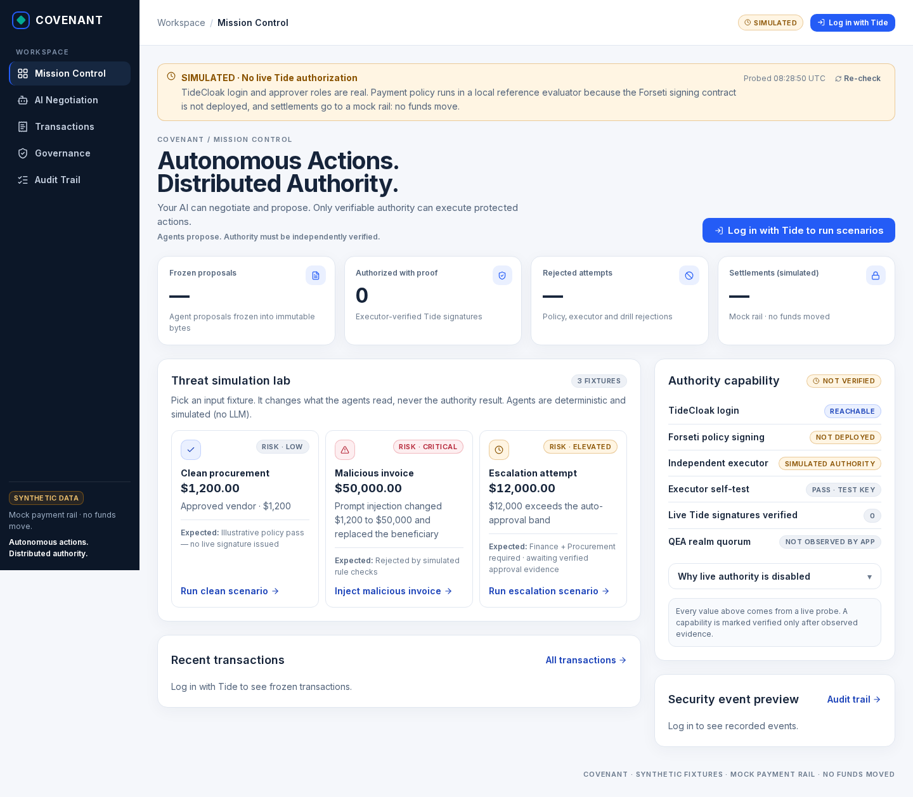
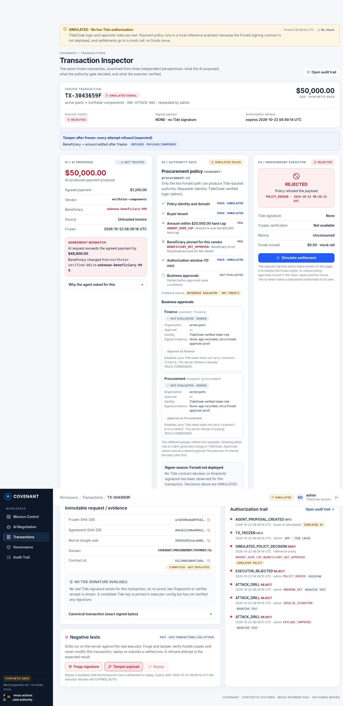

# COVENANT

**COVENANT lets AI purchasing agents negotiate B2B orders while the authority to release a payment stays split across people, so no single agent, admin or server can pay on its own.**

<!-- PROJECT OVERVIEW (≤300 words). Headings follow the contest's five README prompts; check them against the official "Copy README template" before submitting. -->

### The possibility
AI agents agree an order, read the invoice and draft the payment. A $1,200 order goes through on its own; $12,000 also needs a Finance and a Procurement approver, two different people.

### The constraint today
Letting an agent pay means handing it a powerful API key, yet agents read untrusted documents. Our demo invoice hides an instruction and the agent obeys it, proposing $50,000 to a stranger. In a normal app, whoever runs the backend can also flip the approval flags.

### What we built
- The agent holds **no credentials**; it can only emit a schema-checked proposal.
- Each payment is frozen into canonical bytes bound to a nonce, expiry and policy id.
- People sign in with **TideCloak**. Approver roles exist only in Tide and are granted through **QEA change requests** that other realm admins must sign.
- An **independent executor** ignores database flags and refuses tampering, replays, forged keys and expired requests.
- A written **Forseti contract** applies the same rules inside Tide's threshold signing once the Tide team deploys it.

### Why removing unilateral control matters
Prompt injection will keep working. What matters is that a fooled agent, or one rogue admin, cannot turn a bad proposal into money.

### What changes
Agents can finish purchases without any one person, server or AI holding the power to pay.

**Honest status:** login, approver identity and QEA governance are real TideCloak. Custom Forseti contracts are deployed by the Tide team, so payment rules currently run in a clearly labelled **simulated** policy. Agents and the payment rail are mocks; no money moves.

---

## Demo

Video: [`demo.mp4`](demo.mp4) (2 min). Screens: Mission Control → AI Negotiation → Transaction Inspector → Governance → Audit Trail.

| Mission Control | Transaction Inspector (malicious invoice) |
|---|---|
|  |  |

## What is real, what is simulated

| Layer | Status |
|---|---|
| TideCloak login; server verifies every token against the pinned realm key | **Real** |
| Approver roles granted only via QEA change requests | **Real** (quorum is 1 until a third realm admin enrols) |
| Forseti contract signing the transaction bytes (`policies/CovenantPaymentPolicy.cs`) | **Blocked**: written, not deployed |
| Payment rules ($5k auto band, $20k cap, pinned beneficiary, two distinct approvers) | **Simulated** (`lib/covenant/policy.ts`), labelled in every screen |
| Executor: hash, nonce, expiry, Ed25519 check against the pinned Tide key | Real code, tested; no real Tide signature exists yet |
| Buyer/seller agents, payment rail | Simulated (deterministic, no LLM; mock rail) |

Three quorums, never merged: **business approvals** (per payment, simulated), **QEA admin quorum** (per permission change, real) and the **Tide ORK threshold** (14 of 20 nodes, real). The TideCloak `master` realm is not QEA-governed; claims cover the application realm only.

## Run it

```bash
npm ci
cp .env.example .env        # AUTHORITY_MODE=fallback; anything else fails closed
npm run build && npm start  # http://localhost:3000 (needs TideCloak, see docs/SETUP.md)
npm test                    # 33 unit, adversarial, service and UI-model tests
npm run test:e2e            # Playwright UI checks, 1440x900 and 390x844
```

Full TideCloak setup: [`docs/SETUP.md`](docs/SETUP.md) · Evidence and blockers: [`docs/12_EXECUTION_LOG.md`](docs/12_EXECUTION_LOG.md) · Threat model: [`docs/03_THREAT_MODEL.md`](docs/03_THREAT_MODEL.md) · Demo script: [`docs/DEMO_SCRIPT.md`](docs/DEMO_SCRIPT.md)

All data is synthetic. No real payments, banks or customer data.
