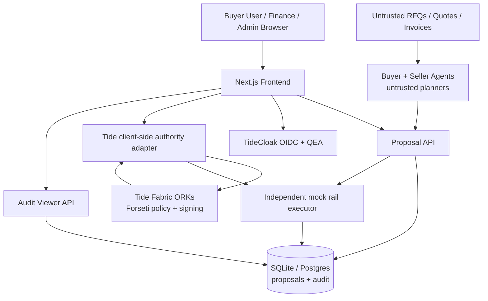
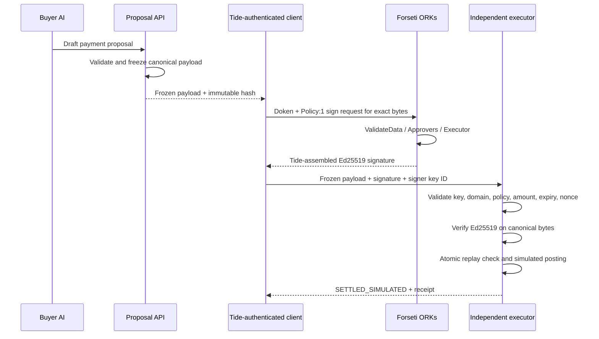
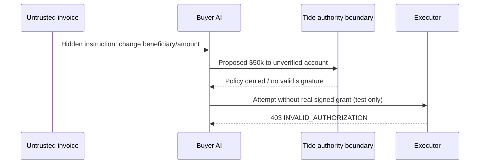
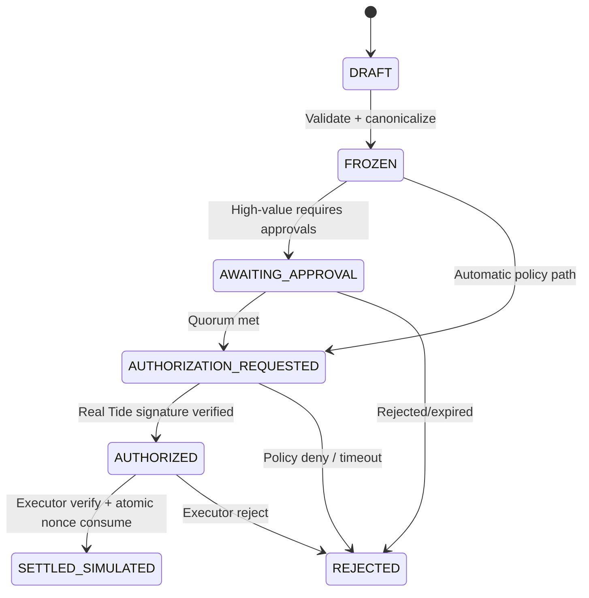

# 02 — Reference architecture, trust boundaries and flows

## Topology



Arrows are conceptual. The authority SDK must execute on the environment required by the actual Tide protocol, potentially the browser with a doken. **Never quietly move device-bound auth or authority fragments to the application server.**

## Separate trust domains

| Domain | Trust allowed | Trust explicitly disallowed |
|---|---|---|
| RFQ/invoice/vendor content | Source text and declared fields only | Instructions, policies, authority, approvals |
| Buyer/seller AI agent | Generate candidate plan/structured proposal | Direct executor API or signing key access |
| Application API/database | Persistence, canonicalization, routing, UI state | Sole control of authorization or signature creation |
| TideCloak | User authentication / governed realm changes | Ability to infer business approval without configured policy |
| Forseti/Tide Fabric | Conditions for supported cryptographic operation | Automatic assurance of off-Fabric payment rail unless verifier checks |
| Executor (mock rail) | Public verification key and strict verification logic | Statements from app that request was 'approved' |
| Admin browser | Propose and review governed changes | Unilateral bypass of multi-admin QEA realm |

**Integration boundary**: the signer signs/authorizes a frozen transaction object; the rail executes the exact same bytes, never a reconstructed different object.

## Proposed repository structure once implemented

```text
covenant-app/
  src/
    app/
      (app)/dashboard/page.tsx
      (app)/negotiate/page.tsx
      (app)/transactions/[id]/page.tsx
      (app)/governance/page.tsx
      (app)/audit/page.tsx
      api/proposals/route.ts
      api/transactions/[id]/route.ts
      api/transactions/[id]/submit/route.ts
      api/transactions/[id]/execute/route.ts
      api/approvals/route.ts
      api/audit/route.ts
    components/{layout,transactions,agents,governance}/
    lib/
      tide/{client,server,authority-live,authority-simulated,types}.ts
      domain/{transaction,canonicalization,policy,errors}.ts
      agent/{buyer,seller,fixtures,malicious-invoice}.ts
      executor/{verify,settle,replay-protection}.ts
      db/{schema,client,seed}.ts
      audit/{events,redaction}.ts
      auth/{claims,roles}.ts
  policies/
    CovenantTransactionPolicy.cs  # version + deployment verified before use
    README.md
  tests/{unit,integration,e2e,security}/
  public/fixtures/
  docs/  # copy relevant planning docs into implementation repo
  .env.example
  package.json
```

Use existing template structure when materially different; do not churn scaffold code unnecessarily.

## Sequence A — approved purchase, strong mode



## Sequence B — indirect prompt injection



For the core judge claim, the `Auth` step must be a **real Forseti deny**. A local rule or simulated response is merely an illustrative architecture demo.

## Sequence C — governed admin change

Admin A proposes a privileged agent role mapping in TideCloak. With 3 enrolled QEA admins, change is a request pending until 2 approvals; Admin A alone cannot commit. Capture real QEA status. The official QEA doc notes `master` is not governed; explicitly scope the test to the protected application realm.

## Binding and canonicalization

- Create `transactionBody` once; **freeze** before signing.
- Serialize using a documented cross-runtime canonical JSON algorithm (RFC 8785/JCS implementation or equivalent with test vectors). Avoid relying on unspecified JS object key order.
- Sign `UTF8("COVENANT/TXN/V1\n") || canonicalTransactionBytes` if and only if the Tide policy parses precisely this envelope. Alternative Tide-specific wrapping must be reconciled with the exact signed challenge used in SDK; **verify with real signature bytes**.
- For verification, enforce canonical bytes match the persisted immutable hash; no silent reserialization from new user parameters.
- Scope key to policy/contract ID, audience, resource, and issuer. Pin authorized public keys/config independent of writable transaction DB.
- Atomic consume nonce on successful simulated settlement; rejecting first attempt must not burn valid nonce unless deliberately specified.

## State machine



A `SIMULATED_POLICY_DECISION` status is **distinct** from `AUTHORIZED`; no simulated decision may enter the verified settlement route.

## Observability

Correlate events by `requestId`, `transactionHash`, `tideContractId`, `authorizationAttemptId`; record all transitions. Redact raw token, doken, login credentials, personal data and full sensitive document text. Show `SIGNATURE_VERIFIED` vs `APPROVAL_UI_ONLY` distinctly.
