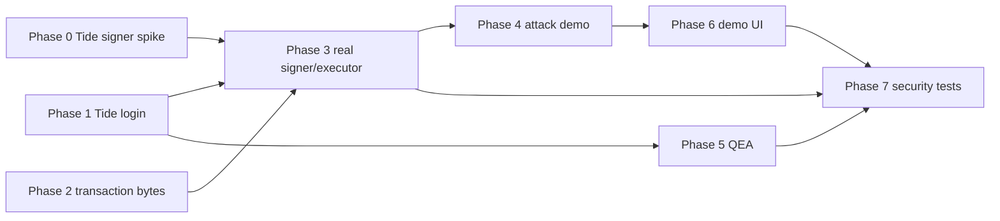

# 08 — Agent-executable delivery roadmap with milestones

## Operating rule

Follow the order. Verify a **real signed cryptographic operation** before spending time on full UI polish. Every milestone ends with code, passing checks, recorded evidence and an honest status in `docs/12_EXECUTION_LOG.md`. If a step needs human Tide enrolment or approvals, document the exact action and continue with independent work.

## Phase 0 — API feasibility spike (P0, first)

**Dependencies:** Raziel MCP connected, Docker/Node available.

- [ ] Inspect repository, existing files, package versions. Do not overwrite user work.
- [ ] Read official current TideCloak docs and ask Raziel for actual Forseti contract deployment playbook.
- [ ] Verify TideCloak dev server boot and Next.js SDK initializer path.
- [ ] Identify custom policy source format, contract ID computation, deployment controls, approval mechanism and actual signing interface.
- [ ] Obtain actual signing key identifier, public key verification material and exact signed byte semantics.
- [ ] Compile / deploy minimal policy that checks a property of a fixed signed challenge if available.
- [ ] Obtain one legitimate Tide-issued signature for known bytes, verify independently.
- [ ] Reject a policy-invalid challenge within Tide and capture denial.
- [ ] Update log with `F0/F3: VERIFIED` or precise `BLOCKED` reason and fallback limitations.

**Gate:** Do not label a local code-only policy evaluator as Forseti if this fails.

## Phase 1 — Identity and development environment (P0)

- [ ] Scaffold from official Tide Next.js starter (existing project? integrate instead).
- [ ] Authenticate real buyer operator; add auth redirect and secure server-side JWT checks.
- [ ] Verify unauthorized endpoints return 401/403.
- [ ] Record server app origin, realm, role mappings and no committed secrets.
- [ ] Add `.env.example`, `.gitignore`, docker scripts and readable startup docs.
- [ ] `npm run lint`, `npm run typecheck`, `npm test`, `npm run build` pass (add missing scripts).

**Gate:** Live login works; API rejects unauthorized caller.

## Phase 2 — Domain data and security contract (P0)

- [ ] Define strict `TransactionV1` Zod schema in `src/lib/domain/`.
- [ ] Implement deterministic canonical serialization with fixtures and test vectors.
- [ ] Add seeded synthetic buyer/supplier/invoice records, allowlist source identity.
- [ ] Create persistence models and transaction state machine; enforce legal transitions.
- [ ] Add audit event recording and redaction.
- [ ] Make `POST /api/transactions` freeze exact immutable signed bytes and hash.
- [ ] Test numeric boundaries: $0, $5,000.00, $5,000.01, $20,000.00, $20,000.01; mismatched vendors, currency, unknown fields and duplicate nonce.

**Gate:** Frozen DTO, hash and DB cannot be modified silently via public APIs.

## Phase 3 — Authority gateway and verifier (P0, core)

- [ ] Define `AuthorityGateway` live vs simulator interfaces.
- [ ] Implement **live Tide Policy:1 signer** via confirmed SDK, browser-bound doken, C# contract deployment.
- [ ] Ensure policy rejects evil beneficiary/$50k, verifies exact payload and per-role approval if available.
- [ ] Implement independent verifier accepting only Tide-sourced trusted public key and exact challenge bytes.
- [ ] Implement executor mock rail: atomic nonce consumption, idempotent settlement, no alternative execution path.
- [ ] Test valid signature, altered amount/account, unknown key, expired grant, replay and concurrent requests.
- [ ] Add explicit `CAPABILITY_LEVEL` info derived from tests, not just `.env` string; simulator is always clearly identified.

**Gate:** In live mode, no fake or bypass signature can create `SETTLED_SIMULATED`.

## Phase 4 — Agents and malicious invoice (P0)

- [ ] Script buyer and seller agent negotiation with structured RFQ/quote/invoice.
- [ ] Introduce `injected_invoice` fixture; visibly show the attacker-controlled text.
- [ ] Agent proposes $50,000/unverified beneficiary; show origin as untrusted.
- [ ] Send that proposal through **the same real signing boundary**; denial proven.
- [ ] Add normal case and $12k approval exception case.
- [ ] Optional live LLM behind `LLM_MODE=off|provider`; server-side credential only, restricted tool set.

**Gate:** Repeat all scenarios offline with consistent output and no external payment service.

## Phase 5 — Governance and approvals (P1)

- [ ] Configure 3 actual Tide `tide-realm-admin` accounts in application realm.
- [ ] Attempt a governed role change; capture state after only first admin endorsement.
- [ ] Capture 2-of-3 governance after second admin if authorized by test setup.
- [ ] Implement finance/procurement approval UX and bind approvals to transaction hash.
- [ ] If Forseti supports independent business approver signing, integrate and test real insufficient-quorum rejection.
- [ ] Otherwise mark approval UI `WORKFLOW_ONLY` and do not claim distributed per-transaction approvals.

**Gate:** QEA is evidenced from Tide itself; transaction business quorum status honest.

## Phase 6 — Design and demo-ready UX (P1)

- [ ] Dashboard with health badges based on actual integration probe.
- [ ] Negotiation transcript and source document inspection.
- [ ] Side-by-side agent proposal vs Tide authority verdict vs mock rail status.
- [ ] Transaction explorer: policy ID, hash, signature verification, audit timeline.
- [ ] Governance screen linking real Tide console, explanatory capability labels.
- [ ] Responsive polish, accessible states, screenshots with synthetic data.

**Gate:** Judge can understand product + trust bottleneck in <30 seconds.

## Phase 7 — Adversarial verification and delivery (P0/P1)

- [ ] Run full test matrix in `docs/09_TESTING_EVIDENCE.md`.
- [ ] Review secrets and dependencies, check no committed credentials.
- [ ] Verify no AI tool or public route can execute rail without signature.
- [ ] Test browser refresh, repeated requests, simultaneous replay and network outage.
- [ ] Generate evidence bundle with sanitized logs and timestamped screenshots.
- [ ] Create README <=300-word contest overview followed by separate setup instructions; confirm real capability claims.
- [ ] Produce a <2-minute MP4 under 100 MB, public GitHub repo if submitting.
- [ ] Ensure docs tell judges what is real Tide, mocked rail, and optional simulated agent.

**Gate:** End-to-end independent execution verdict is observed, not fabricated.

## Dependency critical path

## Honest fallback branches

- F3 custom policy **VERIFIED**: prioritize central cryptographic attack/authorization story.
- F3 only generic Tide signature **VERIFIED**: disclose no proof payload-specific cap enforced by Forseti; can still show tampering rejected at executor and QEA governance separately.
- F3 custom signing **BLOCKED** but Tide E2EE/QEA works: pivot protected asset to Tide-encrypted purchase terms + governed access; simulated transaction gating must remain labeled illustrative. Do not claim COVENANT's main guarantee.
- No live Tide integration: submission incomplete relative to challenge; continue documentation and mark blocker.

## Definition of phase completion

A phase is `VERIFIED` only with a command/test/proof or manual Tide-console observation. `IMPLEMENTED` without evidence is `IN_PROGRESS`.
